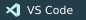

  

<h1 align="center">Penzragon</h1>

<strong>Data Engineer · Vibe Coder · Web Developer</strong>

I work with data, build for the web, and follow ideas wherever they take me.

A little space for the things I'm learning, building, and exploring. 🐺

  

<h2 align="center">🌙 Currently exploring</h2>

<strong>Data engineering</strong> Working with data and building useful pipelines.

<strong>Vibe coding &amp; web development</strong> Turning ideas into things for the web.

Most of my projects live in private repositories. The experimenting continues behind the scenes.

<h2 align="center">🛠 Skills &amp; tools</h2>

<strong>Data engineering &amp; databases</strong>

  
  
  
  
  
  
  
  
  
  
  

<strong>For the web</strong>

  
  
  

<strong>Cloud &amp; everyday tools</strong>

  
  
  
  
  
  
  
  

<h2 align="center">🌃 Contribution city</h2>

  

Each building is a week. Taller buildings mean more contributions; glowing windows reflect active days.

Little steps, late nights, and a white wolf for company.

