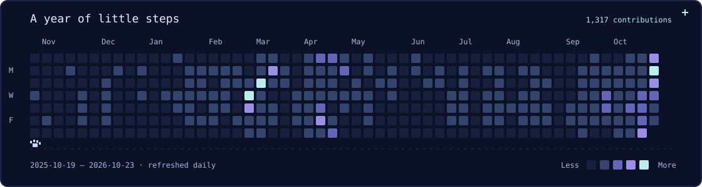

  

<h1 align="center">Penzragon</h1>

Rifky Aliffa

<strong>Data Engineer · Vibe Coder · Web Developer</strong>

I work with data, build for the web, and follow ideas wherever they take me.

A little space for the things I'm learning, building, and exploring. 🐺

  

## 🌙 Currently exploring

- **Data engineering** — working with data and building useful pipelines.
- **Vibe coding & web development** — turning ideas into things for the web.

Most of my projects live in private repositories. The experimenting continues behind the scenes.

## 🛠 Skills & tools

**Data & databases**

       

**For the web**

  

**Build, ship & everyday tools**

       

## ✨ Contribution trail

Little steps, late nights, and a white wolf for company.

